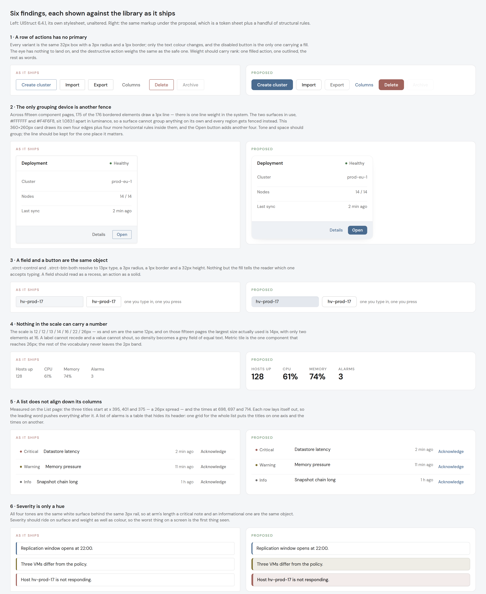

# FR-67: the visual language — weight, surface and scale

**Filed by:** internal design review, 2026-11-03, on strct 6.4.1
**Reach:** every component. The census below reads 15 showcase routes; the token
edits touch all six palette blocks and the component edits touch 8 files.
**Nature:** a token-layer change with component follow-through. It changes the
look of every consumer screen, so it is a major, not a minor.

## What a reader sees

Put six UIStruct screens side by side and they are legible, quiet and
interchangeable. Nothing on any of them is the most important thing. A toolbar
has no action the eye lands on first, a card and the card inside it are drawn
with the same line, a field and a button are the same box, and a critical alert
and an informational note are the same white rectangle with a different coloured
edge. The library reads as a set of correct components rather than as a designed
system, and the reason is measurable: it has one line weight, two surfaces that
do not separate, and no agreed type scale at all.

This report is the census, then nine items. Every number in it was read from
Chrome or counted in the source; none is an estimate.

> **CLOSED, 2026-11-04.** All nine items are answered across 6.5.0, 7.0.0,
> 7.1.0, 7.1.1, 7.2.0, 7.2.1, 7.3.0 and 7.4.0. Seven shipped as asked; FR-67-03
> shipped its radius half and its second line weight was **examined and
> deliberately not shipped** (see that item); FR-67-06 took two releases and
> the second one had to fix the first.
>
> Two things are worth carrying out of this. **The gate has to measure what an
> eye would see, not that two values differ** — FR-67-06 was accepted on
> `surfaces.size > 1`, which passes on a 1.00:1 difference, and a defect rode
> four minor versions on that. And **a component the visual suite does not hold
> is a component nothing contradicts**: the suite had no alert, no card and no
> hero, so neither the 7.0.0 claim nor the first 7.4.0 draft met a picture that
> disagreed. The gates that found both were written after the fact, by going
> back to the census that started the work.

The sheet above is the proposal rendered against the library's own stylesheet:
on the left UIStruct 6.4.1 unaltered, on the right the same markup under a token
sheet and a handful of structural rules. It was produced with
`scripts/`-shaped CDP harnesses, collecting 1 686 live CSS rules from the running
showcase so that the "as it ships" half is the real component CSS and not a
reconstruction of it.

## Measured

### The census

`scripts/` has no census tool yet — this was taken with a one-off CDP harness in
the shape of `scripts/perf-grid.mjs`, walking 15 component routes
(button, badge, tag, card, list, input, select, segmented, alert, empty-state,
tabs, datagrid, toolbar, checkbox, radio) and reading the computed style of every
element carrying a `strct-` class. The `switch` route did not resolve under that
name and was skipped. Arctic Steel · Light throughout.

| Reading                     | Result                                                                |
| --------------------------- | --------------------------------------------------------------------- |
| Bordered elements           | 176, of which **175 draw 1px**. One element in the whole set uses 2px |
| Surfaces in use             | `#FFFFFF` 173 times, `#F4F6F8` 127 times                              |
| Distinct corner radii drawn | 9: 0, 1, 2, 3, 4, 5, 7px, 50%, 999px                                  |
| Distinct font sizes drawn   | 6: 12, 13, 14, 16px, plus 13.3333px and 12.5px                        |
| Largest size actually used  | **14px** (184 elements). 16px appears twice                           |
| Font weights                | 400, 500, 600 — this part is healthy                                  |

The 13.3333px readings are the UA default on elements that set no size and
render no text (`strct-icon`, the visually-hidden `input.strct-cb__native`,
icon-only buttons). It is not a typographic defect and no item below acts on it.

### The surface ramp

| Pair              | Contrast ratio |
| ----------------- | -------------- |
| `--bg-1`→`--bg-2` | 1.083:1        |
| `--bg-2`→`--bg-3` | 1.054:1        |
| `--bg-0`→`--bg-2` | **1.016:1**    |
| `--bg-1`→`--bg-3` | **1.142:1**    |

Six surface tokens span 1.14:1 end to end, and two of them — the app canvas
`--bg-0` (`#f3f4f6`) and the subtle fill `--bg-2` (`#f4f6f8`) — are the same
colour to the eye. A surface therefore cannot group anything on its own, which
is why every region in the library is fenced with a line instead.

### The scale is not used

Counted in `projects/strct/src/lib` and `projects/strct/src/styles`:

|                 | Through the token | Written as a literal |
| --------------- | ----------------- | -------------------- |
| `font-size`     | 75                | **190**              |
| `border-radius` | 87                | **108**              |

The literals are not the token values. `font-size` appears as 10, 10.5, 11,
11.5, 12, 12.5, 13, 13.5, 14, 15, 16 and 18px — eight of those twelve sizes do
not exist anywhere in the scale, and four of them are half-pixels.
`border-radius` appears as 1px twenty times, 2px thirty-eight, 3px seventeen,
4px twenty, and 5px and 7px besides.

So the finding is not that the scale is too narrow. It is that **there is no
scale in force**: there is a token set nobody consults and a habit of typing a
number that looks right next to the number above it. The token scale's own
shape confirms it was never load-bearing — `--text-xs` and `--text-sm` are both
`12px`, two names for one value, and `--text-lg` is used three times in the
whole library.

`border: 1px solid` is written out 142 times. `--b2` is referenced 121 times,
more than any token in the system except `--bg-3`.

### A card, counted

The composite in the sheet above — header, a three-row description list,
footer — is 360×260px and draws its own four edges **plus four horizontal rules
inside them**; the `Open` button adds four more. Nothing in it is grouped by
anything but a line.

### A list, measured

On `/components/list`, the first list's three titles begin at x **395, 401 and
375** — a 26px spread — and the three times at **698, 697 and 714**. Each row
lays itself out, so the width of the leading word decides where the title
starts. Lists whose rows carry no leading element align at 0px spread, which is
how the defect stayed invisible.

## The items

### FR-67-00 — the scale becomes load-bearing

> **SHIPPED in 6.5.0**, and `scripts/visual-regression.mjs` passed all 38
> baselines without re-baselining one, which is the proof that nothing moved.
>
> 249 of the 298 literals became the tokens that already held their values —
> 140 `font-size` and 109 `border-radius`. The remaining 52 are sizes the scale
> cannot express at all (10, 10.5, 11, 11.5, 12.5, 13.5, 15, 17, 18px, and the
> 5px and 7px radii), and rounding them now would have moved pixels, so they
> are listed site by site in the gate's `allowed` map, which only ratchets
> down. They are the worklist for FR-67-01 and FR-67-03.
>
> Two things the report did not anticipate:
>
> - **The scale was declared six times.** `--text-*`, `--radius-*`,
>   `--space-*`, `--control-h-*`, `--icon-size-*`, `--leading-*` and
>   `--disabled-opacity` sat in all six `[data-palette][data-theme]` blocks,
>   174 declarations, byte-for-byte identical. They are palette- and
>   theme-independent, so they moved to `:root` — which is also why FR-67-01,
>   -02 and -03 are now a one-place edit rather than a six-place one. Two side
>   effects, both improvements: the tokens resolve with no palette attribute
>   set, and an app overriding one on `:root` now wins instead of losing to the
>   palette's copy on specificity.
> - **Two radius tokens were missing rather than mis-set.** `--radius-xs: 1px`
>   (the rounding on a 2–4px graphic — a bar cap, a swatch, a tick: 20 sites)
>   and `--radius-pill: 999px` (a shape, not a length: 9 sites, spelled `99px`
>   at five of them and `999px` at four, rendering identically because both
>   clamp to half the box).

**Today:** 190 literal font sizes against 75 token references; 108 literal radii
against 87.

**Asked:** every `font-size` and `border-radius` in the library resolves to a
token. Sizes the scale does not have either join it or round to the nearest step
that does. This is the item every other item rests on — changing a token means
nothing while two thirds of the CSS ignores it.

**Acceptance:** a new gate, `scripts/token-scale.mjs`, fails the build when a
component stylesheet writes a literal `font-size` or `border-radius` (allowing
`0`, `50%`, and the pill `999px`). Run in CI beside `check-docs`.

**Files:** every component stylesheet; the gate is new.

### FR-67-01 — a type scale with real intervals

> **SHIPPED in 7.0.0** as asked: `11 / 12 / 13 / 15 / 18 / 22 / 28`, with
> `--text-md` held at 13px. Every adjacent pair is at least 8% apart and
> `scripts/token-scale.mjs` asserts it. One measured side effect: dropping
> `--text-xs` from 12 to 11px took 12px off the height of the grouped dropdown
> baseline, which is the caption receding, as intended.

**Today:** `12 / 12 / 13 / 14 / 16 / 22 / 26`. `--text-xs` and `--text-sm` are
the same value, so a caption cannot recede below the text it captions.

**Asked:** `11 / 12 / 13 / 15 / 18 / 22 / 28`. `--text-md: 13px` does not move —
it is the body and data size and the library is built on it. The change is a
caption that can sit under a value, and an upper half that can carry one.

**Acceptance:** `scripts/token-scale.mjs` asserts, for all six palette blocks,
that the seven steps are strictly increasing and that each adjacent pair differs
by at least 8%.

**Files:** `projects/strct/src/styles/_tokens.scss` (six blocks).
**Blast radius:** `--text-lg` moves 14→15px and is referenced 3 times;
`--text-xl` moves 16→18px, referenced twice; `--text-3xl` 26→28px, once
(`metric-tile`). The small end carries the weight: `--text-sm` is referenced 49
times and does not move.

### FR-67-02 — a surface ramp that separates without a line

> **SHIPPED in 7.0.0.** The light palettes were re-laddered against `--bg-1`;
> the dark ones only needed `--bg-2` deepened, with `--bg-0` taken down to keep
> its distance. All three thresholds hold in all six palettes and the gate
> asserts them — it caught Ember dark at 1.035:1, under the 1.04 floor, during
> this work. Two things the item did not foresee: `--t3` had to darken in light
> (4.44–4.51:1 on the new `--bg-3` would have been under AA; it now clears
> 4.6:1 on all six light surfaces), and Arctic light turned out to have
> `--bg-h` lighter than `--bg-3`, so a solid button receded on hover. Both
> fixed.

**Today:** the ramp spans 1.142:1 and two of its six tokens are the same colour.

**Asked:** keep the six roles (`--bg-0` canvas, `--bg-1` surface, `--bg-2`
subtle fill, `--bg-3` deeper fill, `--bg-h` hover, `--bg-a` active) and open the
intervals so a step is visible without an edge drawn on it. Light target:
`--bg-1`→`--bg-2` ≥ 1.10:1, `--bg-2`→`--bg-3` ≥ 1.07:1, and `--bg-0` separated
from `--bg-2` by ≥ 1.04:1 or else merged into it and removed. Dark gets the same
rule at its own luminances, measured rather than mirrored.

**Acceptance:** `scripts/token-scale.mjs` computes WCAG relative luminance for
the ramp in all six palettes and asserts those three thresholds. A pass means a
card can sit on the canvas with no border and still read as a card.

**Files:** `_tokens.scss` (six blocks). Text contrast on the new fills is
re-checked by `scripts/a11y-smoke.mjs`, which already runs axe on the showcase.

### FR-67-03 — a second line weight, and a radius scale that is a scale

> **PARTLY SHIPPED in 7.0.0.** The radius half shipped as recommended —
> `2 / 4 / 6 / 10 / 14`, each step at least 1.4× the one below, asserted — and
> the last two literal radii (5px, 7px) were rounded onto it. **The second line
> weight did not ship.** `--b-strong` is a component decision, not a token one:
> which single boundary per region earns it is answered by the drawer, the
> alert and the card, so it moves to stage 3 where those components are
> already being opened. Nothing in 7.0.0 depends on it.
>
> **Examined in stage 3 and not shipped.** With the components open, it has no
> honest user: stage 2 made a surface carry the grouping and stage 3 made
> severity carry the weight, so the one boundary that wanted a heavier line
> turned out to be the alert's rail — which is a rail, and belongs to the alert
> as 3 / 4 / 5px rather than to the token layer. A global token with one
> contrived call site is the `--text-xs` == `--text-sm` mistake this report was
> written about.

**Today:** 175 of 176 bordered elements draw 1px, and `--radius-sm/md/lg/xl` are
`2 / 3 / 4 / 6` — a four-step scale spanning 4px, which at a 32px control height
is 6% to 19% of the height and reads as a right angle at arm's length.

**Asked, lines:** `--b1` stays the hairline between rows of the same thing;
`--b2` stays the edge of a surface; introduce `--b-strong: 2px`-weight usage for
the one boundary per screen that separates two different things (a drawer from
the page, a critical alert from a note). The rule is one strong line per region,
not a new default.

**Asked, radius:** `--radius-sm: 4px`, `--radius-md: 6px`, `--radius-lg: 10px`,
`--radius-xl: 14px`. The example sheet rendered `5 / 7 / 12`; this lands one
notch tighter because the library's controls are 26/32/38px and 7px on a 26px
control starts to read as a pill rather than as a soft rectangle. The numbers
are the recommendation, not the point — the point is that the steps are
distinguishable.

**Acceptance:** `scripts/token-scale.mjs` asserts the four radius steps are
strictly increasing with each step at least 1.4× the one below; visual
regression re-baselined.

**Files:** `_tokens.scss` (six blocks), plus whatever FR-67-00 converts.

### FR-67-04 — weight carries rank in a row of actions

> **SHIPPED in 7.0.0.** `primary` and `critical` are filled and set in 600,
> the default `neutral` is a `--bg-1` solid on a `--b3` edge, `outline` is
> transparent on the lighter `--b2`, `flat` is a word in the accent, and a
> disabled action is transparent on `--b1` at weight 400 — the lightest thing
> in the row rather than the heaviest. `solid` is kept and still fills a
> neutral. Covered by 10 of the 28 checks in `scripts/weight-ladder.mjs`.

**Today:** `primary`, `neutral`, `outline`, `flat` and `critical` are the same
32px box with a 3px radius and a 1px border; only the text colour differs. The
only button in the set carrying a fill is `disabled`.

**Asked:**

- `primary` — filled with `--acc`, text `--inv`, weight 600.
- `critical` — filled with `--critical`, same weight. A destructive action
  should not have to be read to be recognised.
- `neutral` — `--bg-1` on a `--b3` edge: the outlined rank.
- `outline` — transparent on `--b2`: quieter still.
- `flat` — no border, no fill, accent text, tighter inline padding: a word.
- `disabled` — never the only filled thing on screen; transparent on `--b1`,
  text `--t4`, weight 400.

A `solid` modifier already exists (`.strct-btn--solid.strct-btn--primary`); this
item makes solid the meaning of `primary` rather than an opt-in on top of it,
which is the part that changes consumer screens.

**Acceptance:** a browser gate in the shape of `scripts/control-height.mjs` that,
for a toolbar holding one of each variant, asserts exactly one filled background
among the enabled buttons, that `critical` is filled, and that `disabled` is
not. Plus the visual-regression pair.

**Files:** `projects/strct/src/lib/button/button.ts`.
**Migration:** consumers who wrote `strct-btn--solid` on a primary keep working;
consumers who relied on primary being an outline see a filled button. Named in
`docs/migration-7.md`.

### FR-67-05 — a field is a recess, a control is a solid

> **SHIPPED in 7.0.0.** `--bg-3` fill, transparent border, a 1px inset shadow,
> and a full `--acc` edge on focus. The measured starting point was worse than
> the report said: on the showcase stage the field's `--bg-2` fill was
> **1.000:1** from the surface behind it, not 1.083:1 — the stage is `--bg-2`
> too, so the fill was doing literally nothing. Now 1.104:1.

**Today:** `.strct-control` and `.strct-btn` both resolve to 13px type, a 3px
radius, a 1px border and a 32px height. Only the fill differs, and the fill that
differs (`--bg-2`) is 1.083:1 from the surface behind it.

**Asked:** a field reads as a recess — `--bg-3` fill, transparent border, a
1px inset top shadow — and takes its edge only on focus, where `--acc` draws it.
A button keeps its edge. The two stop being the same object without either
changing size.

**Acceptance:** a check in the same gate asserting that, at rest, the field's
background differs from the surface by ≥ 1.07:1 and that its border colour is
transparent; and that focus restores a visible `--acc` edge. Keyboard focus is
already covered by `scripts/a11y-smoke.mjs` and must stay passing.

**Files:** `projects/strct/src/styles/_forms.scss`.

### FR-67-06 — severity rides on surface and weight, not hue alone

> **SHIPPED in 7.0.0** for the alert and **CLOSED in 7.4.0** for the hero and
> the card. Rails step 3 / 4 / 5px on all three, and the weight step sits where
> each component has room for it: the alert's and the card's body go to 500,
> while the card's header is already 600 and does not move.
>
> The caution in this note — "their status language is a rail on a surface that
> may itself be tinted by the app, and getting that wrong is louder than
> leaving it" — turned out to be the right thing to be careful about, and the
> first version of 7.4.0 got it wrong anyway. A tone that _replaces_ a
> component's own `--bg-1` composites over the page instead of over the
> component, and in the three dark palettes a 12% tint then lands **1.045:1**
> from the page: the loudest thing on the screen reads as a hole in it. The
> tone has to be a layer on top of the component's surface
> (`background-image: linear-gradient(var(--critical-bg), var(--critical-bg))`
> over the `--bg-1` that is already there), which paints **1.17:1** from a
> quiet one.
>
> **The alert shipped in 7.0.0 with that defect and nobody saw it for four
> minor versions,** because the check this item was accepted on asked only that
> the tones not share one surface — `surfaces.size > 1` passes on a 1.00:1
> difference as happily as on a 1.17:1 one. 7.4.0 holds all three components to
> a measured step against the quiet tone beside them, and fixes the alert.
>
> A card is not a banner. A hero takes the fill whole; a card's tone is its
> header's, because a flooded 400px card shouts where the point was to be read
> first.

**Today:** `info`, `success`, `warning` and `critical` alerts are the same
`--bg-1` surface behind the same 3px rail; only the rail's hue changes. The
palettes already define `--success-bg`, `--warning-bg` and `--critical-bg` at
12% tone and the alert does not use them.

**Asked:** `warning` takes `--warning-bg` and a 4px rail; `critical` takes
`--critical-bg`, a 5px rail, a 500-weight body and a `--b1` bottom edge; `info`
and `success` stay quiet. The worst thing on a screen becomes the first thing
seen, and it survives being printed or read by someone who does not see the hue.

**Acceptance:** a browser check reading the four tones' backgrounds and rail
widths; and the axe run must stay clean on the tinted surfaces.

**Acceptance, as it ended up:** `scripts/weight-ladder.mjs` reads what each
tone actually _paints_ — its own background colour plus any solid layer in
`background-image`, composited over the surface behind it — and holds the two
loud tones to 1.07:1 against the quiet one, their text to 4.5:1 on the surface
they end up with, their rails to a step, and the critical body to a weight
step. 102 checks across alert, card and hero in six palettes; **45 of them fail
on 7.3.0**, three of those on the alert that 7.0.0 called done. Three clipped
baselines (`alert-severity`, `card-severity`, `hero-severity`) join the visual
suite, which held no alert, card or hero at all.

**Files:** `projects/strct/src/lib/alert/alert.ts`. `hero` and `card` carry the
same status language (`--card--accent/success/warning/critical`) and follow in
the same change for consistency.

### FR-67-07 — a list aligns down its columns

> **SHIPPED in 7.1.0, as the default.** `strct-list` is one grid and the rows
> and their main areas are subgrids of it, so the tracks are sized from the
> content of the whole list rather than stated — which was the condition the
> item put on making it the default. Measured on the List page: titles 395 /
> 401 / 375 → **401 / 401 / 401**, metas 698 / 697 / 714 → **685 / 685 / 685**.
>
> Two things the item did not foresee:
>
> - **A grid charges its gap whether the cell has content or not**, so a row
>   with no leading marker would have paid 8px of dead space at its start. The
>   spacing moved out of the row's `gap` and onto the parts, which already
>   collapse when empty.
> - **The visual suite could not see this release.** With `list.ts` reverted,
>   all 38 baselines still matched: each held either no list or one whose rows
>   carried leading markers of a single width. A `list-alignment` page was
>   added, and it fails by 0.90% of its pixels when the grid is taken away.

**Today:** titles 26px apart, times 17px apart, because `.strct-li__main` is a
flex row and each row sizes itself.

**Asked:** `.strct-li__main` becomes a three-track grid — leading, text, meta —
so every row in a list shares one set of axes. The tracks size from the list,
not the row.

**Open question inside this item:** whether the grid is the default for
`strct-list` or arrives as `strct-list --aligned`. The default is better design
and the riskier change: a list of two rows with a long leading badge will
reserve a wider first track than it does today. Recommendation: default, with
the track widths derived rather than fixed, and the opt-out being the existing
`--wrap` behaviour.

**Acceptance:** a browser check asserting a 0px spread across titles and across
metas for a list whose leading words differ in width — the mirror of the 26px
and 17px measured above, so it fails on 6.4.1.

**Files:** `projects/strct/src/lib/list/list.ts`.

### FR-67-08 — a card groups by tone, not by a second fence

> **SHIPPED in 7.0.0.** The header's rule and the footer's rule are gone and
> the footer's `--bg-2` fill does the separating. Measured on the showcase's
> composed card: **6 drawn border edges before, 4 after** — the report's
> figure of 8 was for the richer composite in the before/after sheet, which
> also held a description list.

**Today:** `.strct-card__header` draws a `--b1` bottom edge, `.strct-card__footer`
draws a `--b1` top edge and fills with `--bg-2`, and a description list inside
draws a `--b1` rule between every pair. A 360×260px card ends up with eight
drawn edges before its contents.

**Asked:** the header loses its rule and keeps its space; the footer keeps its
fill, which does the same work once FR-67-02 makes the fill visible, and loses
its rule; the card gains the resting shadow it already has a token for
(`--shadow-rest`). Rules between rows of a description list stay — that is the
one place a hairline is the right tool.

**Acceptance:** a browser check counting drawn border edges inside a composed
card: 8 today, 4 after (the card's own). Visual-regression pair.

**Files:** `projects/strct/src/lib/card/card.ts`.

## Staging

Each stage is a release that stands on its own and passes every gate.

| Stage | Version | Contents                                                                      | Why here                                                                                                                                   |
| ----- | ------- | ----------------------------------------------------------------------------- | ------------------------------------------------------------------------------------------------------------------------------------------ |
| 1     | 6.5.0   | FR-67-00 and `scripts/token-scale.mjs`                                        | No visual change at all: literals become the tokens that hold their current values. The gate lands first so every later stage is enforced. |
| 2 ✓   | 7.0.0   | FR-67-01, -02, -03 (the radius half; the second line weight moved to stage 3) | The token layer. One release, because type, surface and radius read as one change and splitting them means three rounds of re-baselining.  |
| 3 ✓   | 7.0.0   | FR-67-04, -05, -08 and -06 for the alert (hero and card follow later)         | The component weights. They depend on stage 2's surfaces and are meaningless before it, so they ship in the same major.                    |
| 4 ✓   | 7.1.0   | FR-67-07                                                                      | The list grid is the one item that changes layout rather than appearance; it gets its own release so a regression is attributable.         |

Stage 1 is genuinely behaviour-free and should be verifiable by
`scripts/visual-regression.mjs` passing **without** re-baselining. If it does
not pass, a literal was not equal to the token that replaced it, which is itself
worth knowing.

## Compatibility

- Stages 2–4 change the look of every consumer screen. That is the intent, and
  it is why they are a major.
- The escape hatch is the mechanism the library already has: a
  `[data-visual='6']` block in `_tokens.scss` restoring the 6.x radius, type and
  surface values, documented in `docs/migration-7.md` and kept for one major.
  It restores tokens only — the component weight changes in FR-67-04/05/06/08
  are not reverted by it, and the migration note must say so plainly.
- HyperStruct is the first consumer. Its four overview pages are the right
  acceptance screens, and the two-theme mock-ups already made for them are the
  reference for what the result should look like.

## Gates this work must leave green

`npm test` · `npm run lint` · `scripts/check-docs.mjs` ·
`scripts/a11y-smoke.mjs` · `scripts/visual-regression.mjs` (38 baselines, all of
which change in stage 2 — they are re-taken deliberately, one by one, not with
a blanket `--update`) · `scripts/grid-layout.mjs` (13 checks) ·
`scripts/control-height.mjs` (162 boxes) · and the new
`scripts/token-scale.mjs`.

The CSS budget in `angular.json` is `anyComponentStyle` 20kB error; stage 1 may
move it either way and the changelog records the reason, as 6.4.1 did.

## What this report does not cover

- **Dark palettes.** Every number above is Arctic Steel · Light. The thresholds
  in FR-67-01/02/03 are written as rules so the gate can hold dark to the same
  standard, but the dark values themselves are unmeasured and must be read
  before they are chosen.
- **Ember and Sage.** Same: the rules apply, the numbers were not taken.
- **The data components.** `datagrid` alone contributed 804 of the census's
  elements — more than the other fourteen routes together — and `charts`,
  `heatmap` and `timeline` were not walked at all. They carry their own visual
  language and deserve a separate review rather than a paragraph in this one.
- **Motion.** Not looked at.
- **The `switch` route**, which did not resolve under that name.
